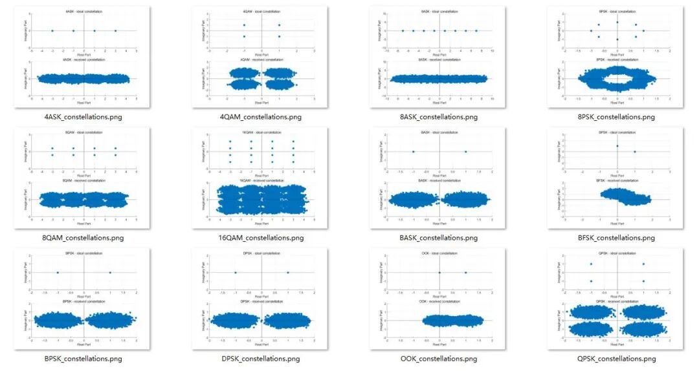
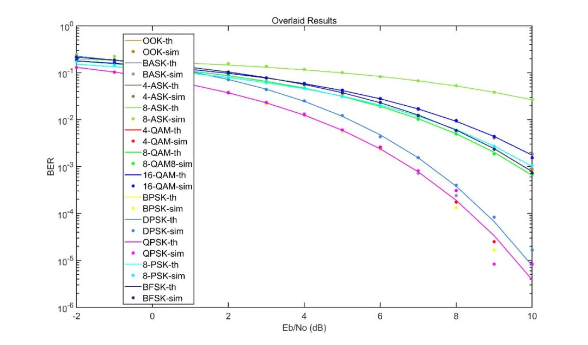

# Error rate curves and constellation diagrams of 12 modulation schemes under different signal-to-noise ratio environments [with MATLAB code]

The objective is to simulate these technologies through additive white Gaussian noise (AWGN) channels, calculate the analog bit error rate (BER) and theoretical bit error rate (BER) according to the signal-to-noise ratio (Eb/No), and visualize the signal constellation.
Calculate the relationship between the simulated and theoretical bit error rates (BER) with the signal-to-noise ratio (Eb/No), and intuitively display the signal constellation.
For each run, randomly generate 120,000 input bits and assume the bit energy (Eb) as unit.
To fairly compare different schemes, an equivalent normalized symbol energy space can be achieved by comparing the noise level with the number of symbols (M) in the modulation scheme.
MATLAB code to display clc; \nclear all; \nclose all; \nSNRdB =5; % -2 : 1 : 10; \nSNR = 10.^(SNRdB/10); \n​\n[OOK_BER_th, OOK_BER_sim] = OOK(); \n[BASK_BER_th, BASK_BER_sim] = BASK(); \n[ASK4_BER_th, ASK4_BER_sim] = ASK4(); \n[ASK8_BER_th, ASK8_BER_sim] = ASK8(); \n​\n[BPSK_BER_th, BPSK_BER_sim] = BPSK(); \n[DPSK_BER_th, DPSK_BER_sim] = DPSK(); \n[QPSK_BER_th, QPSK_BER_sim] = QPSK(); \n[PSK8_BER_th, PSK8_BER_sim] = PSK8(); \n​\n[QAM4_BER_th, QAM4_BER_sim] = QAM4(); \n[QAM8_BER_th, QAM8_BER_sim] = QAM8(); \n[QAM16_BER_th, QAM16_BER_sim] = QAM16(); \n​\n[BFSK_BER_th, BFSK_BER_sim] = BFSK(); \n​\n​\n%---------- Plotting the BER ----------%\n% Define some additional colors needed for plotting\ncolor1 = [0.8 0.5 0.0]; \ncolor2 = [0.6 0.5 0.7]; \ncolor3 = [0.5 0.5 0.3]; \ncolor4 = [0.5 0.9 0.2]; \ncolor5 = [0.2 0.5 0.9]; \ncolor6 = [0.1 0.1 0.5]; \n​\n​\n%%%%%%%%%%%%%% ASK %%%%%%%%%%%%%%\n​\nplot(SNRdB, OOK_BER_th, 'Color', color1); \nhold on; \nplot(SNRdB, OOK_BER_sim, '*', 'Color', color1); \nhold on; \n​\nplot(SNRdB, BASK_BER_th, 'Color', color2); \nhold on; \nplot(SNRdB, BASK_BER_sim, '*', 'Color', color2); \nhold on; \n​\nplot(SNRdB, ASK4_BER_th, 'Color', color3); \nhold on; \nplot(SNRdB, ASK4_BER_sim, '*', 'Color', color3); \nhold on; \n​\nplot(SNRdB, ASK8_BER_th, 'Color', color4); \nhold on; \nplot(SNRdB, ASK8_BER_sim, '*', 'Color', color4); \nhold on; \n​\n%%%%%%%%%%%%%% QAM %%%%%%%%%%%%%%\n​\nplot(SNRdB, QAM4_BER_th, 'r'); \nhold on; \nplot(SNRdB, QAM4_BER_sim, 'r*'); \nhold on; \n​\nplot(SNRdB, QAM8_BER_th, 'g'); \nhold on; \nplot(SNRdB, QAM8_BER_sim, 'g*'); \nhold on; \n​\nplot(SNRdB, QAM16_BER_th, 'b'); \nhold on; \nplot(SNRdB, QAM16_BER_sim, 'b*'); \nhold on; \n​\n%%%%%%%%%%%%%% PSK %%%%%%%%%%%%%%\n​\nplot(SNRdB, BPSK_BER_th, 'y'); \nhold on; \nplot(SNRdB, BPSK_BER_sim, 'y*'); \nhold on; \n​\nplot(SNRdB, DPSK_BER_th, 'Color', color5); \nhold on; \nplot(SNRdB, DPSK_BER_sim, '*', 'Color', color5); \nhold on; \n​\nplot(SNRdB, QPSK_BER_th, 'm'); \nhold on; \nplot(SNRdB, QPSK_BER_sim, 'm*'); \nhold on; \n​\nplot(SNRdB, PSK8_BER_th, 'c'); \nhold on; \nplot(SNRdB, PSK8_BER_sim, 'c*'); \nhold on; \n​\n%%%%%%%%%%%%%% FSK %%%%%%%%%%%%%%\n​\nplot(SNRdB, BFSK_BER_th, 'Color', color6); \nhold on; \nplot(SNRdB, BFSK_BER_sim, '*', 'Color', color6); \nhold on; \n​\nxlabel('Eb/No (dB)'); \nylabel('BER'); \ntitle('Overlaid Results'); \nset(gca, 'YScale', 'log'); \nlegend('OOK-th', 'OOK-sim', 'BASK-th', 'BASK-sim', '4-ASK-th', '4-ASK-sim', '8-ASK-th', '8-ASK-sim', '4-QAM-th', '4-QAM-sim', '8-QAM-th', '8-QAM8-sim', '16-QAM-th', '16-QAM-sim', 'BPSK-th', 'BPSK-sim', 'DPSK-th', 'DPSK-sim', 'QPSK-th', 'QPSK-sim', '8-PSK-th', '8-PSK-sim', 'BFSK-th', 'BFSK-sim'); Simulation results

## Images

<!-- PAYMENT_BLOCK -->

## Get this dataset

- Payment link (Stripe): [Buy now](https://buy.stripe.com/3cs8yP7sY87d0vu9AB)
- Payment QR code: 

<!-- /PAYMENT_BLOCK -->
